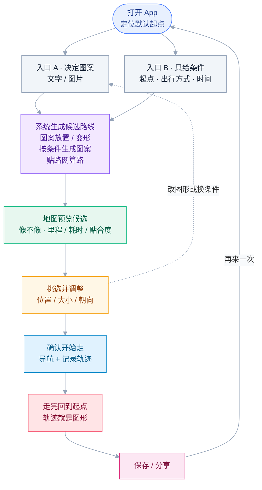

# DrawInMap

在地图上规划出想要的图形的路线。

> **当前 Web 原型的实现边界**（与下文产品定义有出入，以本行为准）：
> - **只实现步行**——底图与路网都是步行 profile（OSM foot）；跑步可复用同一路网，
>   驾车/骑行尚未接入。
> - **没有时间维度**——尺寸与可用时间脱钩：用户原文明确给出的尺寸按显式约束锁定，
>   未给尺寸时由系统在真实路网上多档实测自选（近且像）。`minutes` 一律忽略，
>   "时间不限"也不再追问。
> - 入口二（只给条件 → 实测推荐）已落地；图片**不进入模型**：先在浏览器本地描摹
>   外轮廓作为目标，模型只解析文字里的地点/尺寸等其余需求。
> - 产品形态是手机 App（见下文），当前仓库是验证核心链路的 Web 原型。

## 产品定义

图形是目标，路线是产物：用户想要一个图形，系统把它规划成一条能实际通行的路线。

- 入口一：用户决定图案。说出想画的东西，或上传一张图，系统在地图上把它规划成一条能实际通行的路线。
- 入口二：用户给条件。定位或设置起点；可以用文字或图片指定想要的图形，也可以不指定，系统按条件生成并推荐能画出来的图案。
- 输入规则：出行方式必填，可用时间可选；输入是文字、图片，和/或"起点 + 出行方式 + 可用时间"，图形和条件可只给一个，也可以一起给。
- 图片取线规则：只要能连接的线都要，不局限于外轮廓。
- 不限出行方式：走路、跑步、骑车、开车都可以。
- 产品形态是手机 App，先在 Android 上验证产品可否实现。

## 核心体验闭环

两个入口汇到同一条链路：生成候选 → 预览挑选 → 走完 → 保存分享 → 再来一次。「确认路线 → 开始走 → 走完」这一段在 App 内完成：App 导航并通过 GPS 记录轨迹，走完后把轨迹显示在地图上。

## 预研

### 地图 API 与数据

- 评估 OSM 是否可用；商业地图 API 的验证与接入放到远期。

### 图形规划与贴合

- 如何从用户的输入在地图上规划出图形。
- 路线怎么贴到实际道路上。

### 标注与显示

- 如何把用户的输入，转换成可以在地图上完成的标注。
- 如何在地图上进行标注，有哪些标注方式。
- 记录下来的 GPS 轨迹能否显示在地图上。

### 用户引导

- 如何引导用户完成图形。

## 远期

- 用户自己调位置、大小和朝向。
- 支持不相连的图形；多段、折返、暂停后跳等实现方式届时再定。
- 验证并接入商业地图 API：
  - 使用哪种地图 API；判断时要评估是否支持分段拼接。
  - 确认地图 API 可以提供什么数据。
  - 输入一个经纬度能否获取到该点的信息；是否定位到一个点之后往所有方向获取经纬度，自己构建出附近 XX 公里内的道路图再进行推理。
  - 能否通过附近几百个导航的规划路线把道路推理出来。
