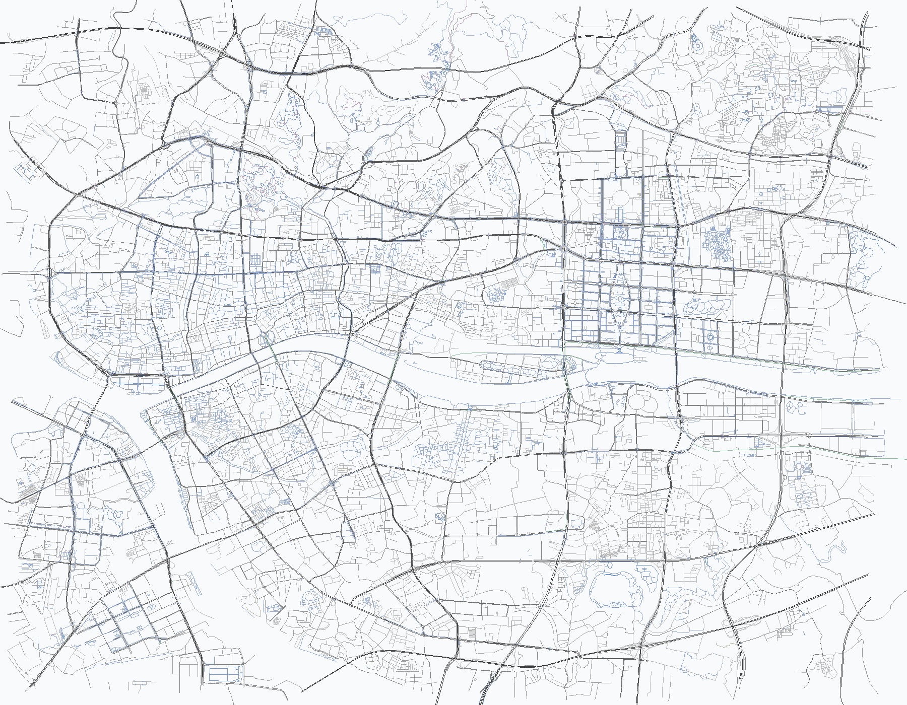

# mapdata · 广州路网数据

本地地图数据目录，为后续"图形路线规划"提供离线路网数据，避免依赖在线 OSM 服务（本机 Overpass/Nominatim/OSM 官方 API 均不可达）。



## 数据来源

- **数据**：OpenStreetMap（ODbL 1.0 许可，展示/分发时需署名 "© OpenStreetMap contributors"）
- **原始文件**：`guangdong-latest.osm.pbf`（广东省 extract，185 MB，来自 OSM France 镜像 `download.openstreetmap.fr`，每日更新）
- **下载方式**：16 连接并发 HTTP Range 分块下载 + 分块续传（本机单连接仅约 29 KB/s，并发后约 300 KB/s，全量约 10 分钟）
- **裁剪范围**：广州核心区 bbox `[113.22, 23.06, 113.36, 23.17]`（约 14 km × 12 km，覆盖广州塔—沙面—北京路—天河核心）

## 文件

| 文件 | 大小 | 说明 | 是否纳入版本库 |
| --- | --- | --- | --- |
| `guangzhou-roads.json` | 6.7 MB | 裁剪后的广州核心区道路几何数据（含立交分层、通行权限、节点引用） | 忽略（可用工具重新生成） |
| `guangdong-latest.osm.pbf` | 185 MB | 广东省原始 OSM 数据 | 忽略（可重新下载） |
| `preview-roads.png` | 383 KB | 路网预览图（数据正确性可视化） | 是 |
| `tools/` | — | 下载、解析、校验、渲染工具 | 是 |

## guangzhou-roads.json 结构

```json
{
  "meta": {
    "source": "OpenStreetMap extract (download.openstreetmap.fr, guangdong-latest.osm.pbf)",
    "license": "ODbL 1.0",
    "bbox": [113.22, 23.06, 113.36, 23.17],
    "generated_at": "2026-10-22T13:17:40+0800",
    "road_count": 26211,
    "highway_types": ["cycleway", "footway", "living_street", "motorway", "..."]
  },
  "roads": [
    {
      "id": 27317865,
      "h": "trunk",
      "n": "猎德大桥",
      "c": [[113.328, 23.115], [113.3285, 23.1162]],
      "r": [126804696, 126805120],
      "b": "yes",
      "ly": 1
    },
    {
      "id": 29118093,
      "h": "secondary",
      "n": "某某路",
      "c": [[113.27, 23.13], [113.2705, 23.1305]],
      "r": [126804697, 126805121],
      "a": {"foot": "no", "bicycle": "no", "horse": "no"},
      "o": "yes"
    }
  ]
}
```

| 字段 | 含义 |
| --- | --- |
| `roads[].id` | OSM way ID |
| `roads[].h` | `highway` 类型（motorway/trunk/primary/secondary/tertiary/residential/service/pedestrian/footway/path/cycleway/steps 等） |
| `roads[].n` | 道路名称（OSM 中约 31% 有名称，其余为空字符串） |
| `roads[].c` | 道路几何 `[[lon, lat], ...]`（WGS84，6 位小数） |
| `roads[].r` | 节点 ID 序列（与 `c` 一一对应，供拓扑重建显式引用；裁剪边界外节点会被跳过） |
| `roads[].b` | 桥梁类型（`bridge=yes/viaduct/boardwalk`，非桥梁时省略） |
| `roads[].t` | 隧道类型（`tunnel=yes/building_passage/passage...`，非隧道时省略） |
| `roads[].ly` | 显式图层 `layer`（整数，桥上为正、桥下为负；无标签时省略） |
| `roads[].a` | 通行权限/限制（`foot`/`access`/`bicycle`/`motor_vehicle`/`motorcar`/`horse`/`wheelchair` 中有值的键） |
| `roads[].o` | 单行道（`oneway=yes/1/...`，无标签时省略） |

> 建图要点：几何相交不代表可通行。判断路口前需先按 `b`/`t`/`ly` 排除不同层（桥/隧道/高架）的交叉；再按 `a` 判断该出行方式（如步行 `foot=no`）是否可通行。

## 数据统计（2026-10-22 快照）

- 道路：**26,211 条**，坐标点 **157,296 个**，全部落在裁剪 bbox（含 0.015° 缓冲）内；JSON **6.7 MB**
- 立交分层：**桥梁 2,293 条**（bridge=yes 1,562 / viaduct 709 / boardwalk 22）、**隧道 1,260 条**（tunnel=yes 1,214 等）、**显式 layer 3,103 条**
- 通行权限：**2,025 条道路带权限/限制标签**（bicycle 1,240 / foot 1,122 / horse 868 / access 432 / motor_vehicle 295 等）；**单行道 9,027 条**
- 拓扑：**117,683 个不同节点**，其中 **31,448 个被多条道路共享**（可直接建图），refs 与坐标一一对应
- 类型分布（Top）：footway 7,702 / service 4,578 / residential 2,122 / tertiary 1,579 / secondary 1,558 / primary 1,472 / steps 1,306 / unclassified 1,261 / trunk 913 / pedestrian 326 / motorway 148
- 命名率 31.3%（小路多无名称，符合 OSM 实况）
- 扩展范围内节点总数 448,656

## 工具用法（`tools/`）

需要 Python 3（仅标准库 + Pillow 用于渲染）：

```bash
# 1. 下载广东省 PBF（约 10 分钟，断点续传）
python mapdata/tools/download_pbf.py

# 2. 解析并裁剪广州核心区路网（约 2.5 分钟）
python mapdata/tools/parse_pbf.py mapdata/guangdong-latest.osm.pbf mapdata/guangzhou-roads.json

# 3. 校验数据质量
python mapdata/tools/verify_roads.py

# 4. 渲染路网预览图
python mapdata/tools/render_roads.py
```

## 用途

- 地图上展示道路（对照底图、调试）
- 后续图形路线规划：图形吸附路网、图搜索、候选路线生成与评分

## 注意

- 数据为每日快照，重新下载会更新（OSM 数据随时间变化）。
- OSM 数据许可：展示或分发时保留 "© OpenStreetMap contributors" 署名。
