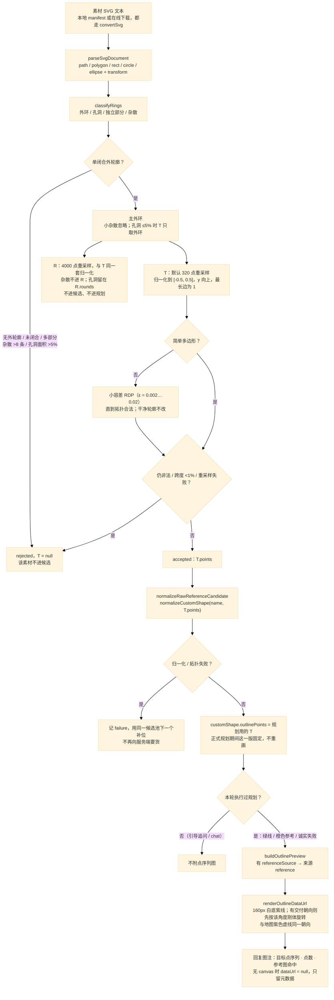
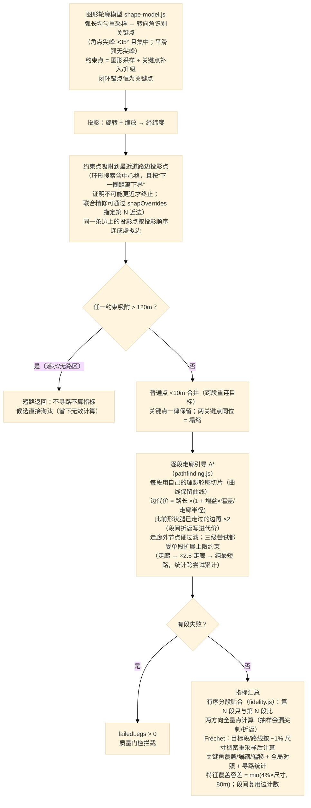
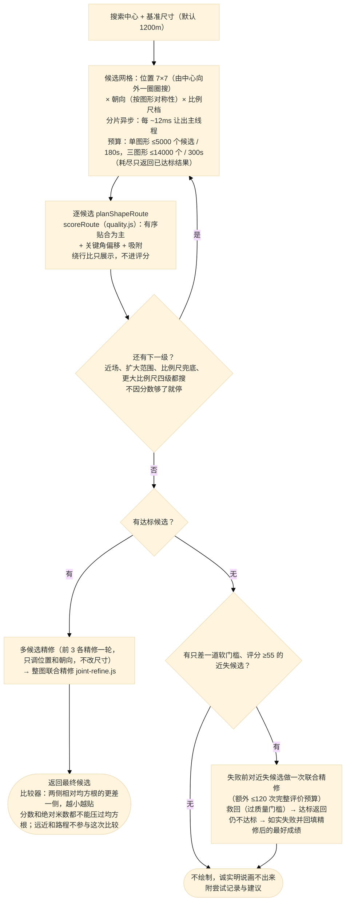
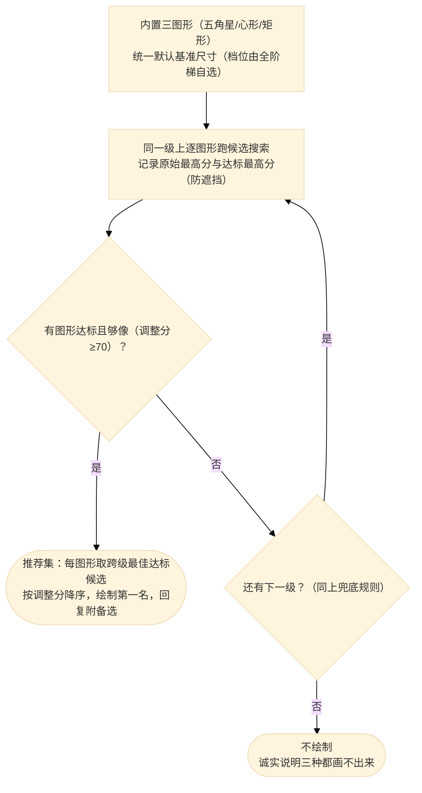
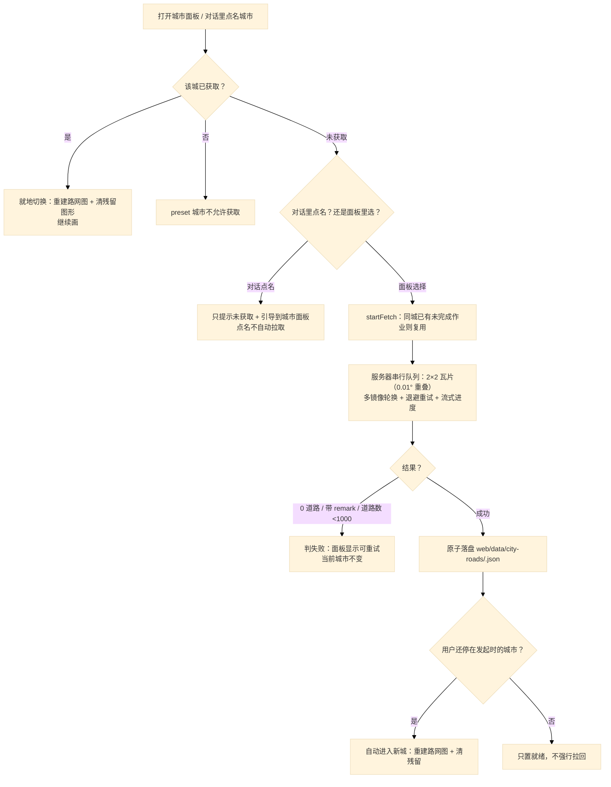

# DrawInMap 主处理流程

四条链路按一次请求的先后排列：编排 → 参考图点列（进路网之前定稿）→ 单图形规划 → 候选搜索。回复里的点序列图在交付时才贴上，仍写在第 2 节，因为它画的就是这一版点列。流程图就是代码的执行路径。

## 1. 智能体编排（agent/controller.js + guide.js）

用户输入（文字 / 图片 / 选项点击）到路线回复的完整编排，含引导式需求确认。

```mermaid
%%{init: {"theme": "base", "themeVariables": {"fontFamily": "Microsoft YaHei, PingFang SC, Noto Sans SC, sans-serif", "fontSize": "14px"}}}%%
flowchart TD
    A([用户输入：文字 / 图片 / 点选项]) --> B{引导进行中？}
    B -- 是 --> C{选项精确匹配？}
    C -- 是 --> D["本地填充槽位（guide.js）<br/>不耗 LLM"]
    C -- "否（自由文本）" --> E["LLM 带历史重解析<br/>mergeIntentInto 合并（新非空优先）<br/>图像描摹目标只合并地点/尺寸，不覆盖描摹 T"]
    D --> F{槽位补齐？}
    E --> F
    B -- "否（全新输入/图片）" --> I["有图片：先本地描摹外轮廓（image-trace.js）<br/>二值化 → 单条填充外轮廓 → 120~320 点 T<br/>抽不出 → 固定拒绝句，不调 LLM、不规划<br/>图片不进模型"] --> I2["LLM 意图解析<br/>system prompt + 最近 4 条历史 + 文字提示<br/>（图片轮只给「系统已直接描摹」括注）"]
    I2 --> J["normalizeIntent 归一化<br/>显式尺寸只信原文本地提取（LLM sizeMeters 忽略）<br/>时间维度已移除（minutes 一律忽略）<br/>plan/recommend 双向兜底<br/>图片轮：强制 plan、customShape=描摹 T、reply 固定"]
    J --> J2{"图形通道校验失败？<br/>（点列自交/退化；shapeSpec Schema 拒绝<br/>或参数化生成失败）"}
    J2 -- "是" --> J3["带失败原因恢复一次（LLM）<br/>点列 → 重生成点列（成功回 plan，缺尺寸基准按默认 1200m 补齐）<br/>规格 → 修正参数重新参数化 / 退回自由点列<br/>仍失败 → planBlocked 诚实失败：不规划、不绘制、<br/>不转实测推荐——生成失败就是失败（2026-10-31 用户裁定）"]
    J2 -- "否 / 恢复成功" --> K{action}
    K -- chat --> R1["直接回复，不触发规划"]
    K -- plan / recommend --> L{"缺槽位？<br/>只有地点槽（时间维度已移除）"}
    L -- 缺 --> M["createGuideState 进入引导"]
    M --> G["回复追问 + 渲染可点选项<br/>地点：配置的前 4 个地标 + 当前视野中心"]
    G -.-> A
    F -- 缺 --> G
    F -- 齐全 --> H["finalizeIntent 定稿<br/>回复「需求明确：地点 · 图形」"]
    L -- 齐 --> H
    H --> N{action}
    N -- plan --> O1["地点解析（place-gazetteer.json 配置驱动，代码零地名）<br/>别名/地标/城市/行政区代表点 + 路网道路名索引<br/>短查询不做子串匹配；覆盖外直接明说<br/>未解析默认追问换地点（不再回退视野中心作画）"]
    N -- recommend --> O2["地点解析（同一套配置驱动解析）+ 统一默认基准尺寸<br/>（档位由全阶梯搜索自选）"]
    O1 --> MO{"多对象请求？<br/>意图给出 ≥2 个请求对象<br/>（方案 2026-11-05 §4.2）"}
    MO -- "部分对象命中本地素材" --> MO1["不规划、不画线、不承诺<br/>列出已命中与缺失对象并追问<br/>（绝不单候选自动规划）"]
    MO -- "全部对象命中" --> MO2["每个对象取一份目标轮廓<br/>按网格组合成 multi-part 复合目标<br/>（各对象按自身最长边归一；同一对象只占一个部分）<br/>逐部分过审，不能用任一部分的审核记录代表整体"]
    MO -- "一个都没命中 / 单对象请求" --> O1b{"三种轮廓同一轮（executeIntent 内、resolveTarget 前，方案 2026-11-01 §2）<br/>本地素材 / 在线检索 / 自由轮廓质检 三路并行发起，卡片随结果到达追加<br/>本地：单字别名词边界+语境守卫、ASCII 词边界、嵌套别名归并、多对象按对象分组（multi）、同区间不同对象=配置碰撞（collision）；§5.5 排序<br/>在线：同源 /__reference 代理（探测失败自动关闭，Openclipart experimental 默认关）<br/>自由轮廓：质检 → 不像时只修正一次（retries=0、180 秒截止）→ 复检；<br/>复杂剪影（LLM 声明特征 ≥3）目标点数 80~120（多部分上限 120×部分数），质检/点数任一不通过该路失败（不入场）；<br/>planBlocked（点列生成失败）时三路无轮廓仍输出具体失败原因，不用固定句覆盖<br/>图像描摹目标（customShape.source=traced）跳过三路"}
    MO2 --> P0
    O1b -- "在线与自由轮廓都失败，且本地唯一整词命中" --> O1c["自动规划：直接固定本地候选<br/>referenceSource 带 origin/审核哈希/contentHash"]
    O1b -- "任意一条可用轮廓（本地/在线/自由轮廓通过）" --> O1d["返回 referenceChoice 待选（候选卡展示实际 T，随结果到达追加）<br/>引擎调用 0 次；点选前剩余路后台继续，点选即取消未返回路<br/>在线标注「在线未审核」、自由轮廓标注「自由轮廓 · 已质检」<br/>chooseReferenceCandidate：校验 choiceId/candidateId/contentHash →<br/>新规划轮 trace（choiceId 串联 sourceTraceId，不重进 LLM/检索）"]
    O1d -.-> A
    O1b -- "三路都没有可用轮廓" --> O1e["不规划、不画线<br/>单对象：回复固定句「没有可用轮廓。」<br/>多对象：点名每个没画出来的请求对象（§4.2）"]
    O1c --> P0
    O1b -- "参考候选未确认（防御）" --> P0
    P0{"统一目标语义验收（target-acceptance.js）<br/>按来源分派：内置 → 几何定义保证；参数化 →<br/>S 几何不变量 + 拓扑复验（确定性，shape-spec.js）；<br/>参考图 → 来源/审核校验 + 拓扑复验（curated 需审核哈希绑定，<br/>在线 unreviewed 需本轮 user-selection 确认，§8）；图像描摹 →<br/>拓扑复验 + 点数 120~320 + 描摹 IoU ≥0.9（确定性，image-trace.js）；<br/>自由轮廓 → 视觉质检闭环（质检→修正→复检，shape-review.js）<br/>∧ 用户显式约束逐项通过（合取，绿线否决权）}
    P0 -- "S/拓扑非法" --> Z0["完全不调用路网引擎<br/>诚实失败（说明参数问题，方案 §8.5）"]
    P0 -- "通过（targetVersion v1/v2）" --> P0c{"交付对象一致性核对（§4.3）<br/>请求对象 = 实际交付对象"}
    P0c -- "多对象请求缺对象" --> P0d["clearDraw 不绘制、不承诺<br/>列出已命中与缺失对象追问"]
    P0c -- "一致 / 单对象命名差异（只记日志）" --> P["正式规划 plan（无副作用搜索，T 全程固定）<br/>路线贴合低不再重画 T（质量追击已取消，方案 §9.2）"]
    P0 -- "不合格 / 未验收（拓扑合法）" --> P1["只做一次诊断性参考规划<br/>结果固定为标注「目标未通过」的橙色非合格参考版<br/>或诚实失败——路线分再高也不转绿"]
    O2 --> Q["实测推荐 recommend（无副作用搜索，不绘制）"]
    P --> S{路线交付闸门}
    P1 --> U
    Q --> S
    S -- "达标且路线贴合 ≥60" --> T["commitDraw 统一绘制最终选定候选<br/>绿线 = 目标验收通过 + 路线验收通过<br/>回复用「路线贴合」表述（双评分不混用）<br/>偏移 >800m 明说；推荐附备选"]
    T --> T2["多比例尺候选池（2026-11-09）<br/>best+alternatives 即本次达标池全量（不重搜）：<br/>可交付过滤 → 按比例尺去重（档内比较器取最优）→ 升序 → 上限 6 档截断（当前版必在）<br/>回复下方候选卡片（尺寸/路线贴合/里程/用时/贴合偏差/覆盖/特征，缺不编造）<br/>点选即时切换：不调 LLM、不重规划，切前按闸门+质量+约束复核；与「要大/小一点的那版」互通<br/>点选是就地操作：不新增对话消息、面板轻提示、消息区滚动位置不动（2026-11-09 交互修正）<br/>新输入/切会话/切城市失效，刷新后消息内静态可见不可点"]
    S -- "不达标 / 低于交付闸门" --> U["clearDraw 不绘制！<br/>诚实说明原因 + 尝试记录 + 建议"]
```

参考图点列的生成见第 2 节（发生在上图 O1b，早于路网）；三路取齐时的自由轮廓质检也在 O1b 完成（不像时只修正一次 + 复检，通过才进候选卡），用户点选后 P0 复用该质检结论、不重复调用模型；规划与搜索见第 3、4 节。多对象请求在 O1b 之前先走多对象参考通道（MO，方案 2026-11-05 §4.2）：只看本地素材、按对象分组比对请求集合，**全部命中**才把各对象轮廓组合成 multi-part 复合目标继续规划；**只命中一部分**就列出已命中与缺失对象追问，不规划、不画线；一个都没命中才交回三路通道。

## 2. 参考图点列与回复点序列图（reference/convert.js + agent/reference.js + buildOutlinePreview）

第 1 节的 O1b 只写到选中哪份素材。点列在那一步、进路网之前生成：SVG → R/T，再把 T 归一化成规划用的 `customShape`，供第 3 节使用。回复底部的点序列图要等到第 1 节交付时才贴上，画的是这一版 T，不是 R，也不是贴路之后的路线。



图注来源五档（`ui.js` 的 `OUTLINE_SOURCE_LABELS`）：`reference` 参考图命中、`procedural` 参数化生成、`traced` 图像描摹、`llm` AI 生成、`builtin` 内置图形。有 `customShape` 且带 `referenceSource` 时才标参考图；`customShape.source='traced'` 时标图像描摹（上传图片经本地描摹成为目标，图片不进模型）；否则按 `customShape.source` 标参数化或 AI，再否则用内置 `buildOutline`。成功、橙色非合格参考、诚实失败展示的是同一版拿去规划的轮廓；有最终候选时图注追加朝向。Node 没有 `document`，`dataUrl` 为 null，气泡不画图。

## 3. 单图形路线规划（engine/planner.js + shape-model.js + pathfinding.js）

把图形轮廓变成一条真实可走的连续路线；内置图形与 LLM 自定义图形走同一条链路，不写图形名称分支。



关键点识别（shape-model.js）：弧长重采样后按转向角找角点，绝对阈值 35° 区分真角与 LLM 圆形点列的量化顶角（~22.5°），集中度排除分散噪声；心形瓣顶等平滑极值不进关键角门槛，交给走廊引导与有序指标。

特征检测（shape-features.js）：深凹口（`notch`）与窄间隙（`gap`）都要求 ≥12% 尺寸的凹深，避免凸多边形浮点噪声产出假间隙；每条真实腿缝保留一个代表（上限 6 条），仅 `notch` 开口宽度与 `gap` 间隙宽度参与起搜尺寸反推。高密有机轮廓（点数 >80）额外检测有界身份浅凹 `identity`（深度 `[0.04, 0.12)`、开口 `[0.06, 0.20]`，上限 4 条），凹底最深点补入关键约束并按凹深米数收紧所在形状腿的走廊上限，计入 `plan.feature.arcs` 日志但不计入 `featureCoverage` 门槛与尺寸反推。

## 4. 候选搜索、尽力链与实测推荐（engine/candidates.js + quality.js + selection.js + large-tier.js + shape-envelope.js）

“换个地方推导、不顺就换比例尺”的搜索与诚实交付：位置、朝向、比例尺逐级尝试。近场、扩大范围、比例尺兜底、更大比例尺四级都会搜，不因某一档分数够了就停。跨档好坏看两侧相对偏差的均方根（更差一侧，越小越贴），不再用绝对米数把大尺寸压回去。



尺寸轴双闸（方案 2026-11-01 §5）的三条硬规则：**所有大档与同一个基线 B 比较**（比较期间不更新 B，中间档不得卡住更大的好档）；**形状绝对误差包络只含三项米制指标**（吸附偏差只走 120m 硬门，关键点/特征只走质量门，都不并入包络）；**胜出大档必须补做精修并重新过闸**（分数更高 + 包络不劣 + 偏移不比请求中心更远），不过即回退到最近一个已验证版本。备选大档展示实际贴合分与形状最大偏差，不再用“更大所以细节更好”的暗示性文案。

**显式约束锁定与交付前复核**（方案 2026-11-08 §3）：用户原文明确给出尺寸/朝向时，约束写成一份契约（`engine/constraint-contract.js`）随规划一路传下去——粗搜只生成"允许的尺寸集合"（请求尺寸本身，阶梯其它档位不参与）、显式朝向只搜该朝向、局部精修不再做 ±10° 扰动；提交绿线前再按"请求约束 vs **最终产物实际值**"复核一次，违反约束的候选不得绿线交付（降级为橙色诊断参考并写明差异，或诚实失败）。未显式指定时，阶梯搜索与选优策略完全不变。

内置三图形实测推荐（入口二）：同一级上逐图形跑候选搜索，取每图形跨级最佳达标候选。



## 5. 城市按需获取（city/ + server.mjs 的 /__city/*）

第 1~4 节都在**当前城市已加载路网**的前提下运行。换城市走独立的一条链路：城市目录
（`web/config/city-catalog.json`，4 直辖市 + 293 地级市，只含名称与中心锚点，不含路网）
→ 服务器按城市中心锚点推导核心区 bbox → 拆 2×2 瓦片向 Overpass 真实下载 →
原子落盘 `web/data/city-roads/<cityId>.json` → 引擎重建路网图 + 清上一城残留。



纪律：获取完成前**当前城市不变**、引擎图不变，用户可继续在当前城市画；换城绝不把
上一座城市的路网用在新城市出图。城市名与地标不写死在代码里——新城没有手写 POI 表，
地点解析只依赖城市名（→ 覆盖中心）与获取到的真实道路名索引。详见
方案设计/2026-11-08-按需获取全国城市路网方案.md。
